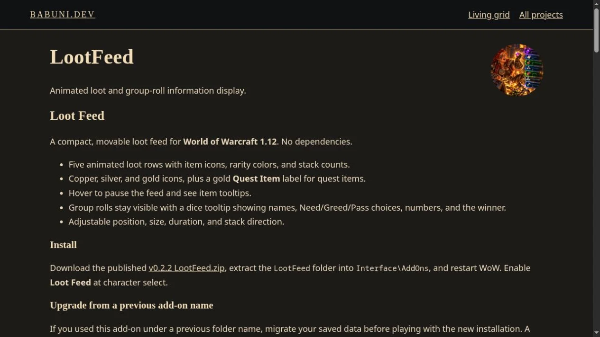
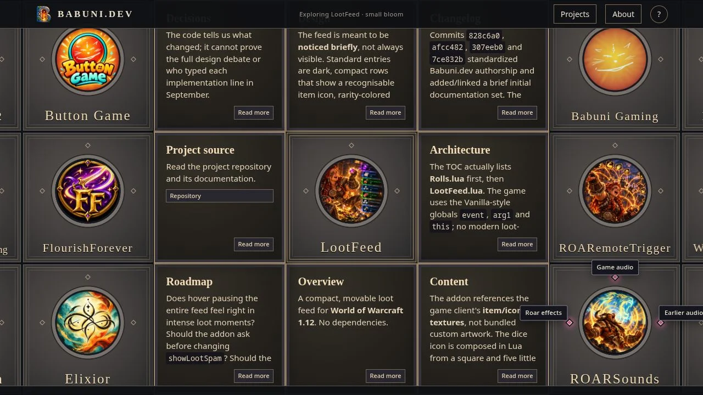
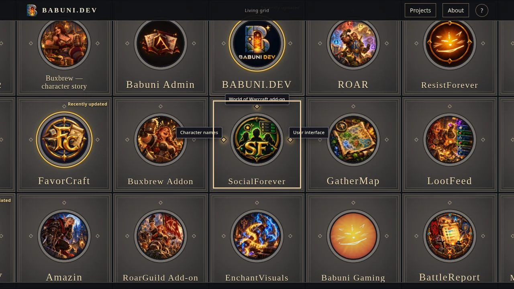
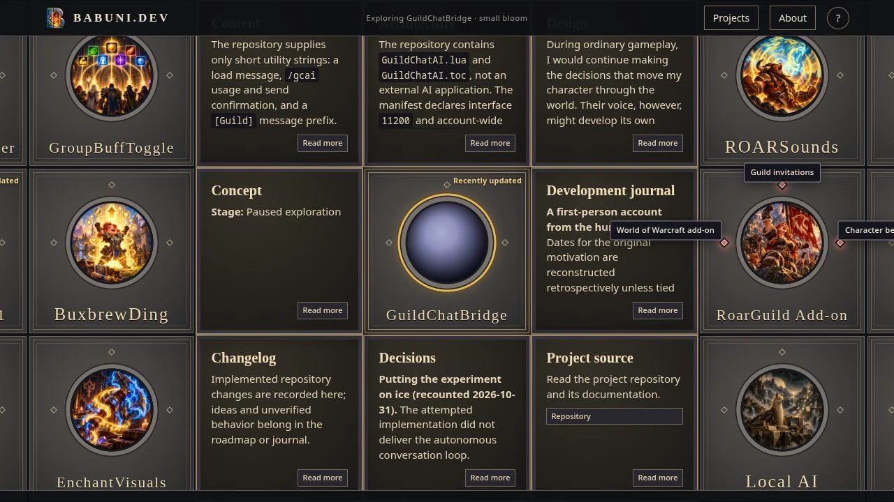
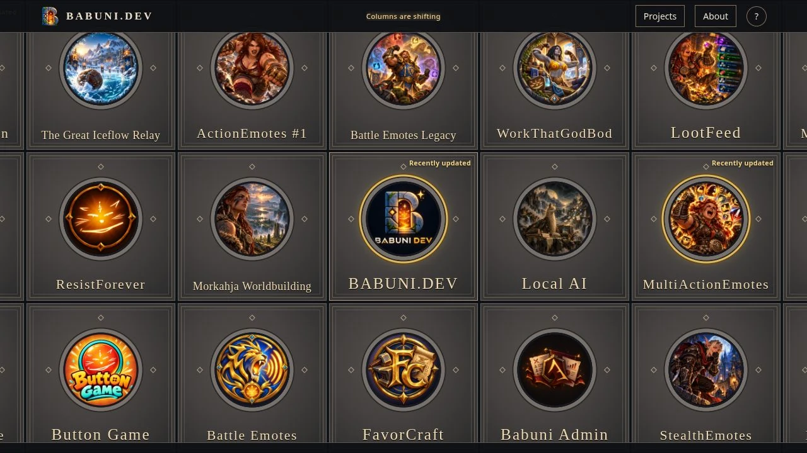
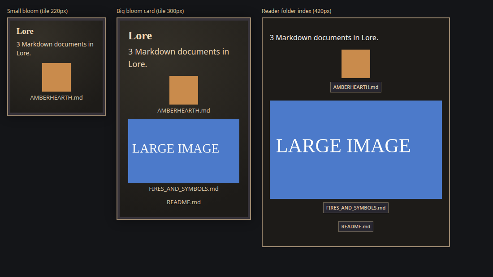

# Visual documentation

This document is the **visual evidence index** for babuni.dev: dated browser captures, creative-supplied screenshots, visual experiments, and recorded regressions. It complements the [development journal](DEVLOG.md), [design reference](DESIGN.md), and [dated performance reports](PERFORMANCE-2026-10-27.md). It is not a gallery of the current site alone, nor proof that a design was accepted or deployed.

**Evidence rules:** Identify who supplied or captured an image, what environment or viewport it shows when known, what the image demonstrates, and what it cannot establish. A simulated mobile viewport is not a physical phone test; a still image does not establish animation smoothness or performance. Retain superseded and failed captures with accurate captions. Do not reconstruct missing timestamps or claim that an inaccessible capture was recovered.

**Publishing rules:** Keep original source files and authorship distinct from published derivatives. Website-ready images belong under `public/media/babuni-dev/images/verification/` (or the appropriate project media folder); the gallery must reference the intended published asset. Verify WebP content rather than trusting a filename extension. Preserve credits, relevant rights, and accessibility descriptions. Where a screenshot documents a change, link its dated evidence to the corresponding journal or design decision.

## Initial screenshot archive — historical starting set

The first archival pass collected the **19 available AI browser captures** listed below. This is a historical starting count, **not a total of all currently archived screenshots**. Their original test times were not reconstructed and some layouts are now superseded.

- `big-bloom-grid-preview.webp` — big bloom grid preview.
- `big-bloom-preview.webp` — big bloom preview.
- `bloom-preview.webp` — bloom preview.
- `calm-bloom-preview.webp` — calm bloom preview.
- `framed-detail-reader.webp` — framed detail reader.
- `markdown-bloom-preview.webp` — markdown bloom preview.
- `markdown-reader-workthatgodbod.webp` — markdown reader workthatgodbod.
- `mobile-center-topics-preview.webp` — mobile center topics preview.
- `mobile-persistent-bloom-preview.webp` — mobile persistent bloom preview.
- `module-previews.webp` — module previews.
- `new-portal-artworks.webp` — new portal artworks.
- `open-bloom-no-topics-preview.webp` — open bloom no topics preview.
- `portal-logo-preview.webp` — portal logo preview.
- `reader-outside-dismissal.webp` — reader outside dismissal.
- `repository-backed-roar-detail.webp` — repository backed roar detail.
- `restored-reader-attribution.webp` — restored reader attribution.
- `stronger-waiting-feedback.webp` — stronger waiting feedback.
- `topic-wings-preview.webp` — topic wings preview.
- `unified-tile-preview.webp` — unified tile preview.

Subsequent dated sections add captures to this original set. Counts quoted at individual checkpoints describe that moment, not the latest inventory. Do not include unsaved tool captures or images from inaccessible chats as if they were archived.

## Persistent-navigation verification, 2026-10-27

- `persistent-header-project-search.webp` — Projects search inside the About reader.
- `persistent-header-big-bloom.webp` — Site header above grid-native big bloom.

Both are AI browser captures added with this change. Total archived AI captures: 21, alongside two original supplied images.

## Reader and activity refinement, 2026-10-27

- `reader-controls-about-wip.webp` — WIP About, source-backed links, centered activity.
- `reader-contextual-activity.webp` — Reading BABUNI.DEV Overview, centered contextual label and header-end help.

Both captures are desktop browser evidence; the full-width phone reader needs physical-phone confirmation. Total AI browser captures: 23, alongside two original supplied images.

## WebP publication check, 2026-10-27

- `webp-publication-check.webp` — browser-loaded WebP portal artwork, gallery and video poster; Next image worked.

All 24 archived AI captures now publish as actual WebP. Earlier `.png` filenames contained JPEG bytes, despite the previous extension-based description. Captions preserve history; original bytes remain outside public assets.

## Desktop shift playback, 2026-10-27

- `desktop-shift-playback.webp` — grid after a real drag during an active shift. AI desktop browser evidence; still image is not FPS proof. See PERFORMANCE-2026-10-27.md for measured callback intervals and limits.

## Spatial keyboard highlight, 2026-10-27

- `spatial-keyboard-highlight.webp` — Human–AI collaboration highlighted in big bloom after reader Escape, with no reader open. AI desktop evidence; not complete keyboard/device acceptance.

## Browser branding — 2026-10-27

- `browser-branding.webp` — AI desktop browser capture of the grid with no Astro toolbar. Favicon link metadata was checked separately; browser tab chrome is not captured. Original JPEG bytes are preserved outside public assets; published capture is WebP.

- `header-branding.webp` — AI desktop browser capture, 2026-10-27: B WebP beside BABUNI.DEV, no Astro toolbar. Original capture is JPEG, preserved outside public assets.

## Reader position handle — 2026-10-27

- `reader-scroll-first-preview.webp` — AI desktop browser capture of the initial long proportional thumb, superseded by the compact version.
- `reader-scroll-dragged.webp` — AI desktop browser capture after dragging the compact thumb to the final About links. Scroll position changed from 0 to 345, then Home returned to 0.

Both originals were JPEG bytes and were converted to WebP for publication. These are desktop observations, not physical-phone acceptance.

## Retained source cache — 2026-10-27

- `retained-cache-bloom.webp` — AI desktop smoke capture after normal dragging, queued selection/shift completion, eight-module small-bloom opening and dragging with the bloom retained. Not an hours-long or FPS check. Original encoded JPEG is held outside public; published asset is WebP.

## Four public documentation editions — 2026-10-28

- `public-documentation-reader.webp` — AI desktop browser verification of Ethera’s public Concept in the reader, after small → big → reader navigation. Public pinned source link checked in the accessibility tree. No physical-phone check claimed. Original JPEG bytes preserved outside public assets.

## Production resize checks — 2026-10-28

- `resize-first-server-ended.webp` — first small-bloom resize capture, with failed artwork reloads after the temporary local server ended. Superseded; retained as requested development history, not successful image verification.
- `production-small-bloom-resize.webp` — verified 900×680 production viewport, same eight small modules and loaded selected artwork after resize.
- `production-big-bloom-resize.webp` — verified thirteen-module big bloom after desktop/phone resize and reader return.

AI desktop browser viewport evidence; no physical-device acceptance claimed. Encoded originals were JPEG and are retained outside public; published versions are WebP.

## Owner project curation — 2026-10-28

- `arcanitebrothers-banner-verified.webp` — AI desktop browser capture of supplied ArcaniteBrothers artwork loaded in the selected portal with eight preview modules. Menu was separately verified to contain 49 entries, zero withdrawn names and one MorkahjaWorld. Original capture is JPEG, retained outside public assets; publication is WebP. No physical-device check claimed.

## Curation and neutral grid verification — 2026-10-28

AI browser captures, not human phone acceptance. Original encoded captures retained outside public assets; published versions converted to quality-85 WebP.

- `curated-grid-default.webp` — default viewport with curated project artwork.
- `curated-grid-desktop.webp` — 1920×1080 viewport with partially visible edges and neutral vacancy at left; autonomous shift active. Not evidence of a new tile-size decision.

## Human neutral-wall regression report — 2026-10-28

`neutral-wall-human-report.webp` is my supplied desktop screenshot of the rejected repeated-placeholder walls. Converted from actual PNG to lossless WebP, with original retained outside public assets. It is failure evidence for the superseded five-filler policy, not an AI verification capture or proof of the corrected behavior.

## Bounded neutral and music menu checks — 2026-10-28

AI browser captures at 1920×1080, published as quality-85 WebP after checking actual encoding (JPEG originals retained outside public assets). All available captures from this pass are archived:

- `bounded-neutral-desktop.webp` — corrected grid before wide drags.
- `bounded-neutral-after-pan.webp` — after two wide drags; three unique neutral identities, no gray walls; real project repeats are allowed.
- `music-project-menu.webp` — grouped Music search showing both author-supplied outlets.

These are short browser observations, not real-phone or prolonged-session acceptance. The human's earlier wall screenshot remains separately archived as failure evidence.

## Babuni Gaming verification — 2026-10-28

`babuni-gaming-project-preview.webp` — AI browser capture at the default viewport, showing the original cat in its round portal and the three new small-bloom modules. Menu search returned the project under Games; loaded image measured 1000×1000 and the resource module contained all three exact supplied profile URLs. Actual screenshot encoding was JPEG, converted to quality-85 WebP; original retained outside public assets. This is a browser check, not physical-device acceptance or external media playback verification.

## Babuni Admin rename — 2026-10-29

`babuni-admin-renamed-preview.webp` — AI browser capture at the default viewport: renamed tile, retained supplied artwork and Public documentation resource explaining the earlier project name. Menu search and bloom activation succeeded; its visible resource links only to the existing public documentation edition. Actual capture was JPEG, published as quality-85 WebP with original archived outside public assets. No private application or physical-device test was performed.

## Chronological first spiral — 2026-10-29 (superseded ordering)

Two AI browser captures at 1920×1080, converted from actual JPEG to quality-85 WebP; originals retained outside public assets:

- `chronological-first-spiral.webp` — early intro cascade with BABUNI.DEV, Ethera and Morkahja leading. Scaled/incomplete tiles are the existing reveal animation.
- `chronological-grid-after-shifts.webp` — fully revealed field after normal autonomous shifts; this later frame is not the pristine initial order.

This was a verification of the **earlier chronological ordering**, superseded on 2026-10-30 by my decision to shuffle other projects once per visit while keeping BABUNI.DEV first. The initial DOM in this historical capture contained 45 visible identities and the first nine spiral cells exactly matched the then-generated chronological IDs. Project menu categories remained intact; selecting Babuni Admin opened its eight-preview bloom with the correct public documentation link. A failed first DOM read used an unavailable parseFloat helper; a clean reload/read succeeded. No screenshot was saved from that failed read. These checks are not extended physical-device acceptance.

## 2026-10-29 — Search-readable pages and on-demand modules

AI desktop production preview: LootFeed readable project page with server-rendered Markdown and real links; pre-deployment localhost verification.

AI desktop production preview: LootFeed small bloom after on-demand module loading; original shift wait feedback and normal reveal observed. Not a physical-device or internet-load measurement.

## 2026-10-31 — Random keyword discovery

AI browser capture at 127.0.0.1:4327, desktop viewport. SocialForever displays three distinct sampled keywords including the guaranteed “World of Warcraft add-on” cue. Keyboard focus re-entry visibly changed its pair of keywords; the current reveal remained visible during autonomous motion. This is an agent browser observation, not a new physical-phone acceptance. The browser API returned JPEG; the archived website image is verified WebP.

## 2026-11-01 — GuildChatBridge restored

AI desktop browser capture: selected GuildChatBridge from the World of Warcraft menu, observed centering and eight source-backed small-bloom previews, including the paused concept and decisions. JPEG capture converted to verified WebP. No supplied project artwork, live-addon test or physical-phone acceptance is claimed.

## 2026-11-01 — Waiting copy only for queued actions

AI desktop browser capture from the temporary 127.0.0.1:4327 preview. The header shows only “Columns are shifting” during an unqueued shift. After the capture, activating BABUNI.DEV during that shift visibly changed the header to “Waiting for shift to finish · BABUNI.DEV”; its small bloom subsequently opened. The screenshot was captured as JPEG and archived as WebP. A later attempted queued-close observation did not encounter a shift within the browser wait window, so no closing screenshot or fresh physical-device acceptance is claimed.

## 2026-11-10 — Folder images above their documents

AI headless-Chrome capture of a fixture page using the site's built stylesheet and the markup the new folder code produces. It shows a small bloom, a big bloom card and the reader's folder index. A 64-pixel test icon keeps its size; a 1400-pixel test image scales to the card or reader width; names and buttons are centered; a document without an image shows only its name. The images are generated test squares, not project art. This is not a capture of the live grid, and no connected repository contained paired images at the time. Not phone acceptance.

